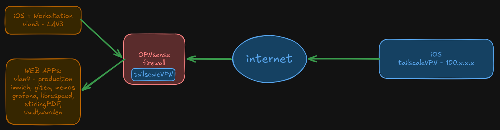

## grafana 

- self-hosted monitoring dashboard 
- running on observer, the Raspberry Pi 4 metrics and log collector
- exposed through nginx proxy manager
- accessible from iOS local or remote(tailscale), and Fedoral locally
- cAdvisor providing Docker VM container visibility
- node exporter runs on OPNsense, TrueNAS, Proxmox-2, Proxmox-2, observer, backup-node and the Docker VM
- Loki and Promtail run on observer for centralized log collection from infrastructure nodes

