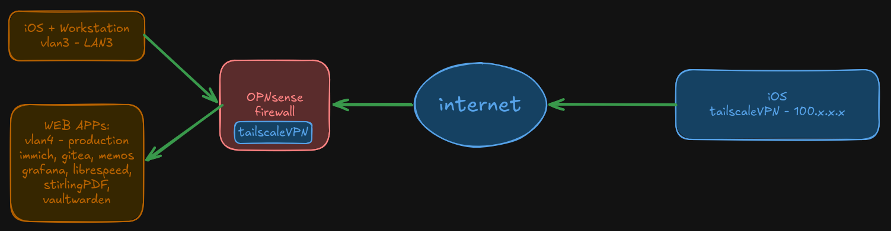
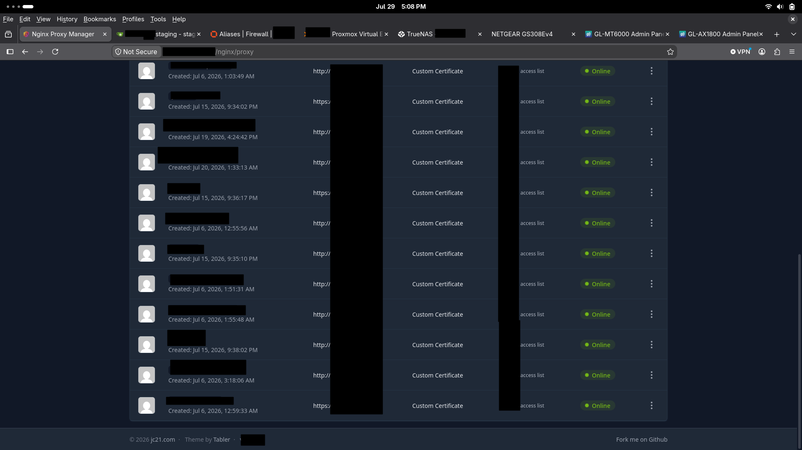

## nginx proxy manager 

- reverse proxy server terminating https connections for my web apps and management ui's
- running on the Docker VM
- exposed through nginx proxy manager
- accessible only from iOS local or remote, and Fedora local
- selfsigned wildcard cert for self-hosted apps
- access list restricted to phone, workstation

