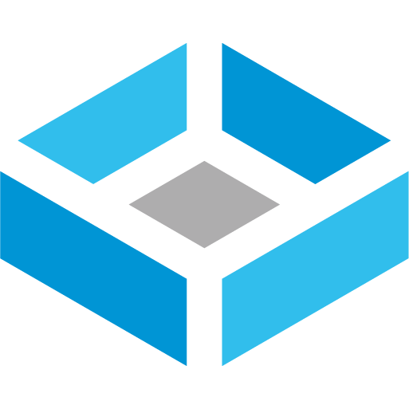
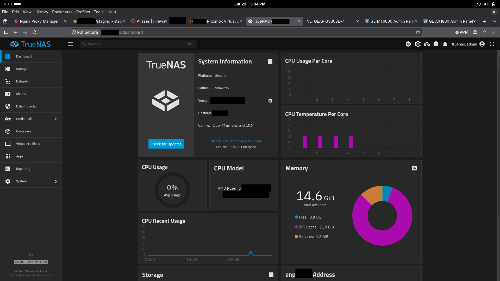

## trueNAS 

- NAS operating system was running directly on TrueNAS, a ThinkCentre Tiny, now moved to VM on Proxmox-1; providing network storage
- web ui exposed through nginx proxy manager
- web ui accessible from workstation with local connection only
- access to SMB shares allowed only to iOS, Fedora, observer and backup-node
- access to NFS share allowed only to the Docker VM, observer and backup-node
- SMB data is stored at /mnt/TANK/NASgul
- NFS data is stored at /mnt/TANK/nfs

