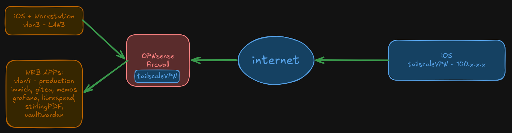
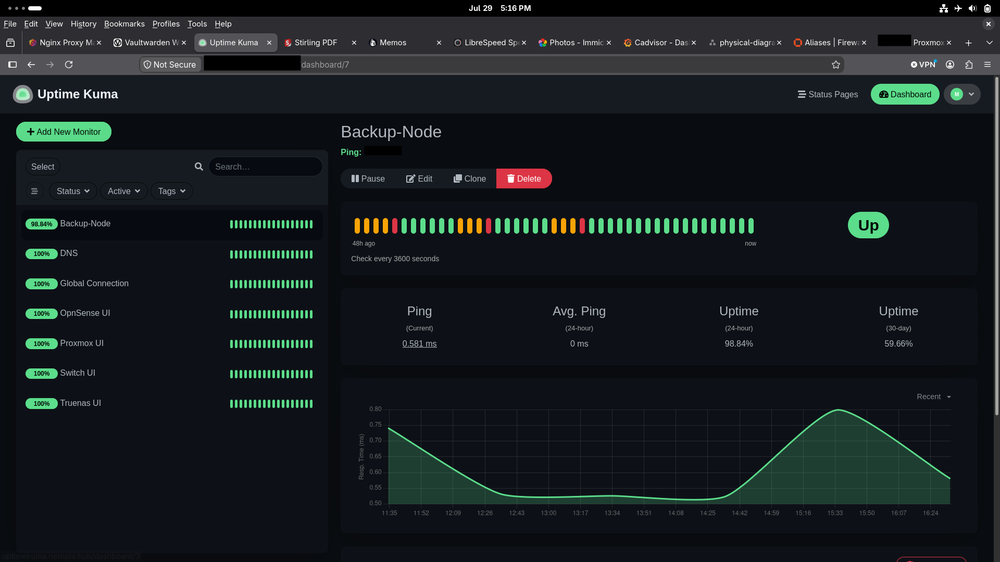

## uptime-kuma 

- self-hosted service monitoring application providing uptime visibility and service outage alerts
- running on the Docker VM
- exposed through nginx proxy manager
- accessible only from iOS local or remote, and Fedora local
- monitor down alerts sent to phone via Discord

