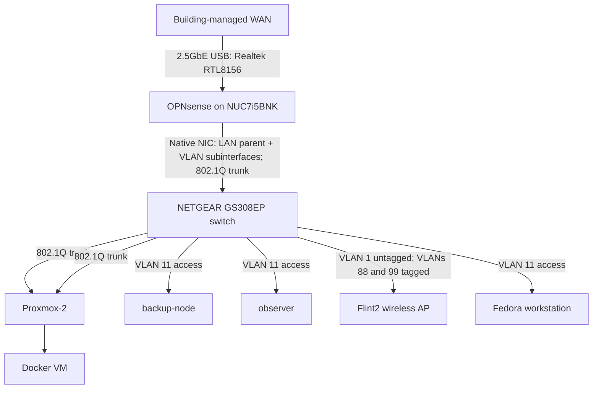

# Network Topology

## Traffic Flow

The building-managed WAN connection terminates on OPNsense's 2.5GbE Realtek RTL8156 USB Ethernet adapter. OPNsense is the default gateway for the homelab; its LAN connection uses the NUC7's native NIC as the parent interface for the VLAN subinterfaces and uplinks to the NETGEAR GS308EP switch. The switch distributes access and tagged VLAN connectivity to the physical nodes and Flint2 wireless access point.

## OPNsense Interfaces

| OPNsense interface | Physical connection | Configuration |
| --- | --- | --- |
| WAN | Realtek RTL8156-based 2.5GbE USB Ethernet adapter | Connects to the building-managed WAN |
| LAN | NUC7i5BNK native NIC to switch port 7 | LAN parent interface; VLAN 1 is untagged and the other VLANs are configured as subinterfaces |

The switch port 7 trunk carries VLAN 1 untagged and VLANs 4, 11, 50, 88, and 99 tagged to the OPNsense LAN parent interface.

## VLANs, Addressing, and DNS overview

The gateway address for each VLAN is the first usable address in its subnet (`.1`). All physical and virtual infrastructure nodes use DHCP reservations.

In the sandbox VLAN (50), DC01 provides authoritative DNS for Windows domain-joined VM clients and forwards internet DNS queries to the network gateway.  

| VLAN | Name | Network | Gateway | Primary purpose |
| --- | --- | --- | --- | --- |
| 1 | LAN | `192.168.33.0/25` | `192.168.33.1` | Native LAN, switch management, and Flint2 management |
| 4 | Production | `10.4.4.0/24` | `10.4.4.1` | Docker VM and production workloads |
| 11 | Management | `10.1.11.0/25` | `10.1.11.1` | TrueNAS, Proxmox, Raspberry Pis, and administration |
| 50 | Sandbox | `10.1.50.0/25` | `10.1.50.1` | Isolated testing and sandbox VMs; DHCP assigned |
| 88 | Roommate's LAN | `10.1.88.0/25` | `10.1.88.1` | Roommate's devices and latency-sensitive devices |
| 99 | IoT | `10.1.99.0/25` | `10.1.99.1` | Smart-home and guest devices |

## Switch Port Layout

The following table is the current physical layout on the switch. `PVID` is the untagged/native VLAN for the port; the tagged list contains VLANs carried with 802.1Q tags.

| Port | Connected device | PVID | Tagged VLANs |
| --- | --- | --- | --- |
| 1 | Proxmox-2 | 11 | 1, 4, 50, 88, 99 |
| 2 | Proxmox-1 | 11 | 1, 4, 50, 88, 99 |
| 3 | backup-node | 11 | None |
| 4 | Unused | 50 | None |
| 5 | Unused | 50 | None |
| 6 | observer | 11 | None |
| 7 | OPNsense LAN | 1 | 4, 11, 50, 88, 99 |
| 8 | Flint2 | 1 | 88, 99 |

## Flint2 Wireless Access Point

The Flint2 has six physical Ethernet ports: the first two are 2.5GbE and the other four are 1GbE. The switch's port 8 trunk connects to the Flint2's second physical port (2.5GbE). On the Flint2, that uplink carries VLAN 1 untagged and VLANs 88 and 99 tagged.

The Flint2 runs in wireless access point mode, with LuCI still available to configure its Layer 2 networking. Unmanaged interfaces are configured for VLANs 1, 88, and 99, and each is associated with an SSID:

| Wireless Network role | VLAN | SSID |
| --- | --- | --- |
| Trusted / LAN | 1 (untagged on uplink) | Trusted / LAN |
| Roommate / guest | 88 (tagged on uplink) | Roommate / guest |
| IoT | 99 (tagged on uplink) | IoT |

## Physical Nodes

- **OPNsense:** NUC7i5BNK firewall and router. The native NIC is the LAN parent interface and connects to the switch; the Realtek RTL8156-based Ugreen 2.5GbE USB Ethernet adapter connects to WAN.
- **Proxmox-1:** ThinkCentre M75q Gen2 Production virtualization host.
- **Proxmox-2:** ThinkCentre M75q Gen2 Staging/Testing Virtualization host.
- **backup-node:** Raspberry Pi 4 used for backups.
- **observer:** Raspberry Pi 4 used for metrics and log collection.
- **Flint2:** GL.iNet Flint MT6000 running OpenWrt in access point mode.
- **switch:** NETGEAR GS308EP managed switch with PoE+.

