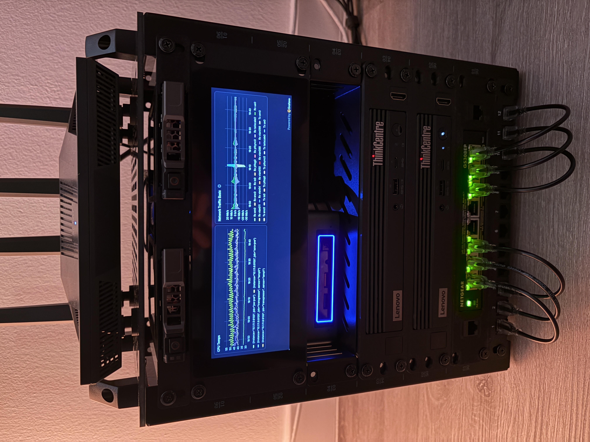

# Nodes

This folder covers the physical machines and network equipment that make up the homelab. The lab has grown from a few small devices into a compact rack, with each system taking on a dedicated role.

## Inventory

| System | Hardware | Role | Profile |
| --- | --- | --- | --- |
| OPNsense | Intel NUC7i5BNK | Gateway, firewall, and routing | [OPNsense](opnsense.md) |
| Switch | NETGEAR GS308EP | Managed switching and PoE+ | [Switch](switch.md) |
| Proxmox-1 | Lenovo ThinkCentre M75q Gen 2 | Production virtualization host | [Proxmox-1](proxmox-1.md) |
| Proxmox-2 | Lenovo ThinkCentre M75q Gen 2 | Staging, testing, and learning host | [Proxmox-2](proxmox-2.md) |
| TrueNAS | Virtual machine on Proxmox-1 | Network-attached storage | [TrueNAS](truenas.md) |
| backup-node | Raspberry Pi 4 | Backups and support tasks | [Backup node](backup-node.md) |
| observer | Raspberry Pi 4 | Metrics and log collection | [Observer](observer.md) |

The Flint2 access point and other network details are documented in the [network topology](../Architecture%20Overview/network-topology.md). For the bigger picture, see the [architecture overview](../Architecture%20Overview/README.md).

## Physical Layout

The core systems are mounted in a small 10-inch rack. The switch provides PoE+ to the Raspberry Pi nodes, keeping the setup a little tidier and giving the monitoring and backup roles their own hardware.
(Images from an earlier state of the homelab, will update soon)

---

Raspberry Pi 4's mounted in the back  
