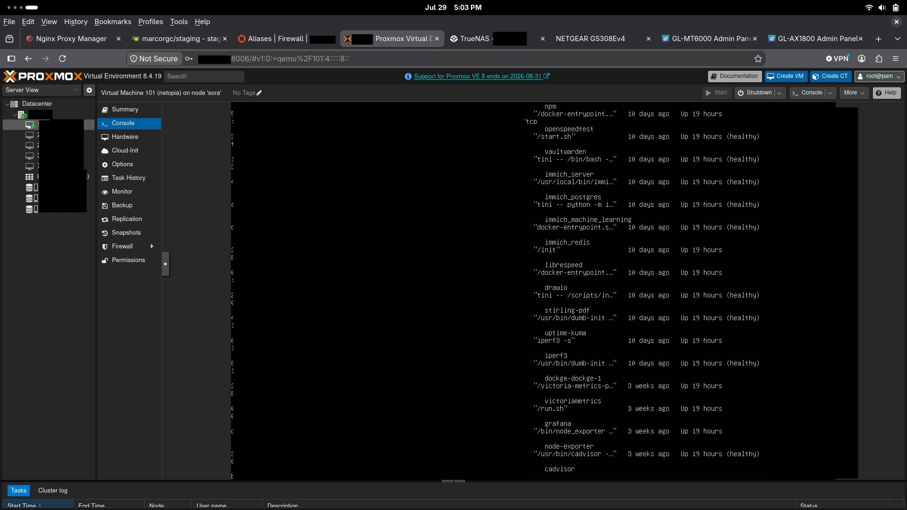

# Node Profile — Proxmox production

**Hardware:** Lenovo ThinkCentre M75q Gen2 Ryzen 4750GE
**Upgrades:** 500 GB NVMe, 1TB SATA, 48 GB 3200 MHz RAM  
**Role:** Proxmox virtualization host  
**Version:** PVE v8.2.1  
**Network:** VLAN 11 management on the switch → 10.1.11.6; VLANs 1, 4, 50, 88, and 99 are tagged through the trunk port

---

## Virtual Machines
- netopia (Docker VM)
- NASgul (Truenas VM)

---

## Services on netopia
AdGuard, Excalidraw, Gitea, Immich, LibreSpeed, iPerf3, Memos, Nginx Proxy Manager, StirlingPDF,  
Uptime Kuma, Vaultwarden, Grafana, cAdvisor, and Node Exporter  
Network Storage provided by TrueNAS SMB/NFS shares

---

## Key configurations
- Proxmox is the Production virtualization host for my self-hosted services and Network Storage.
- The management network is on VLAN 11 while the public-facing and service networks are trunked through the switch.
- Docker workloads are hosted on the `netopia` VM, which is where most of the application layer lives.
- Node Exporter is enabled on the host and on the Docker VM so observer can scrape metrics.
- TrueNAS provides general storage, and critial infrastructure nodes are  configured with cron-based rsync backup scripts pointing to another dataset  
on the host. Observer then performs it's own cron-based rsync script on that  
dataset.

---

## Purpose
This node exists because early on I found an affinity for virtualization but was limited by hardware. Once I had enough compute and storage, Proxmox became the anchor for the lab.

---

## Future Improvements
- Security Improvements
- LXC containers for lightweight services
- High availability and clustering later on if I expand the lab

---

